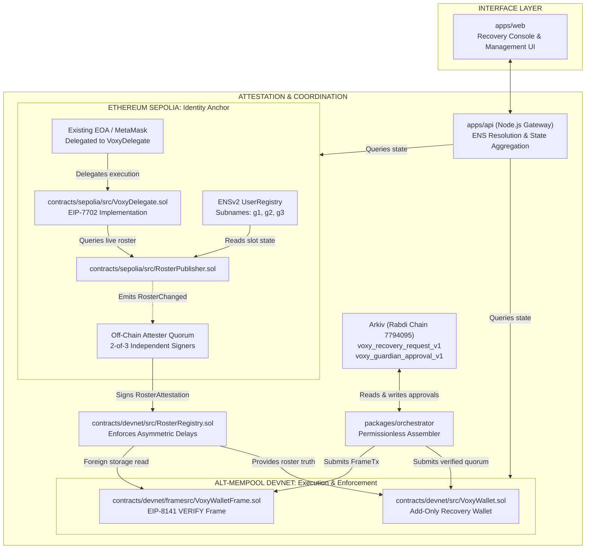
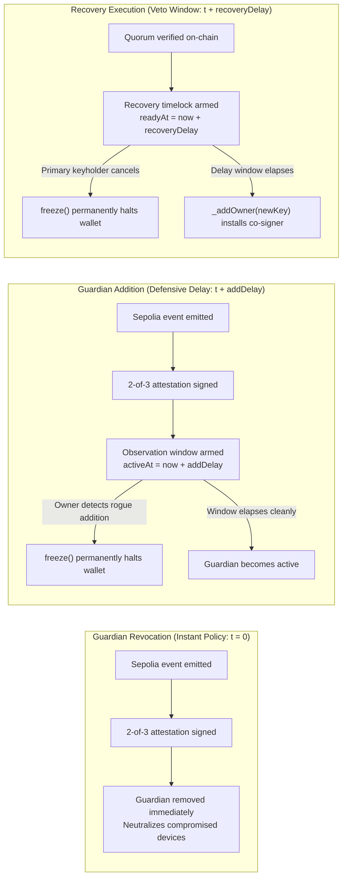
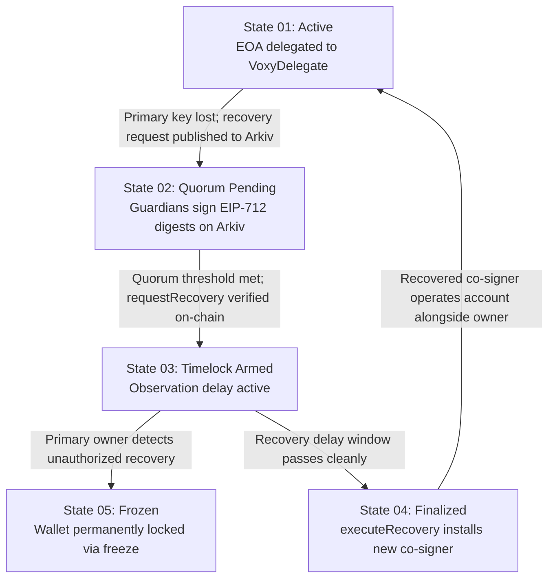

<div align="center">


# VOXY

**Identity-anchored, add-only social recovery for existing EOAs via EIP-7702 and ENSv2.**

[Live Console](https://voxy.v0id.in/) &bull; [Protocol Architecture](#03-the-protocol-model) &bull; [GitHub Repository](https://github.com/kartikeywastaken/voxy)

</div>

## 01. Executive Summary

Voxy enables existing Externally Owned Accounts (EOAs) to establish cross-chain social recovery without asset migration. Guardian rosters anchor to human-readable ENSv2 namespaces rather than static cryptographic keys, approvals coordinate ephemerally over Arkiv, and policy executes on an alternative mempool chain.

By combining EIP-7702 code delegation on Ethereum Sepolia with validation-phase policy enforcement on an alternative mempool execution chain, Voxy ensures that guardian management reflects live identity state rather than frozen key assignments. Recovery execution is strictly add-only: a verified guardian quorum installs a new authorized co-signer alongside the existing key, mathematically precluding guardian-driven asset confiscation.

## 02. Why Voxy's Protocol Design Is Different

Most social recovery architectures are designed around smart contract accounts (such as ERC-4337 contract accounts or Safe multisigs) configured with static cryptographic keys. While these systems establish account recovery mechanisms, they introduce operational trade-offs around key rotation, account continuity, cross-chain state synchronization, and permission governance.

Voxy addresses these trade-offs by combining ENSv2 identity resolution, EIP-7702 in-place delegation, add-only authorization invariants, asymmetric security windows, and decentralized coordination over Arkiv.

### Protocol Comparison

| Dimension | Conventional Social Recovery | Voxy Protocol |
| :--- | :--- | :--- |
| **Guardian Identity** | Static hexadecimal addresses (`0x...`) stored directly in contract storage | ENSv2 human-readable identities (`g1.user.eth`) resolved dynamically |
| **Guardian Key Rotation** | Requires the wallet owner to execute an on-chain transaction to replace stale guardian addresses | Guardians update their own ENS name resolution on Sepolia; Voxy absorbs rotations dynamically |
| **Wallet Continuity** | Typically requires deploying a replacement smart contract wallet or replacing the EOA | Preserves existing EOA address, balances, and history via EIP-7702 delegation on Sepolia |
| **Asset Migration** | Recovering into a new wallet requires sweeping native and token balances across chains | In-place recovery: assets never move from the original account |
| **Recovery Authority** | Implementation-dependent (e.g. static k-of-n thresholds or custom validation modules) | Deterministic 2-of-3 guardian quorum validated on-chain via EIP-712 structured digests |
| **Recovery Operation** | Frequently replaces the primary owner key or transfers account ownership | Strictly add-only: installs a new authorized co-signer alongside the original owner |
| **Guardian Removal** | Typically subject to standard governance or identical timelocks as additions | Immediate revocation policy (`t = 0`) upon cross-chain attestation to neutralize compromised keys |
| **Guardian Addition** | Implementation-dependent (often immediate or uniform delay) | Subject to an on-chain observation delay (`addDelay`, e.g. 48 hours) to prevent rogue insertions |
| **Cross-Chain Configuration** | Requires independent guardian configuration, funding, and maintenance per chain | Canonical Sepolia identity anchor synced to execution chains via signed attestations |
| **Approval Coordination** | Implementation-dependent (centralized relayers, proprietary backends, or manual off-chain transport) | Decentralized coordination over Arkiv (Rabdi chain) with native entity block-height expiries |

### Core Architectural Distinctions and Why They Matter

* **Identity-Based Guardian Resolution via ENSv2:** Storing raw hexadecimal addresses creates silent obsolescence. When a guardian migrates devices or rotates an operational keypair, static configurations fail unless the wallet owner notices and pays gas to update them. By anchoring guardian slots to ENSv2 subnames, guardians manage their own signing addresses independently. The wallet owner's roster reflects current identity state without maintenance transactions.
* **Existing EOA Continuity via EIP-7702:** Migrating to smart accounts traditionally requires deploying a new contract account, migrating assets, and abandoning the existing EOA. This breaks decentralized finance (DeFi) collateral positions, invalidates soulbound tokens, resets on-chain identity history, and creates taxable disposal events. EIP-7702 allows the existing EOA to delegate execution logic in place while maintaining its original address and token balances.
* **Add-Only Recovery vs. Asset Sweeping:** Full-ownership replacement and automated asset sweeps expose accounts to hostile guardian takeover. If a guardian threshold is compromised or coerced, conventional replacement allows malicious guardians to seize full control or drain funds. Voxy enforces an add-only invariant: recovery only authorizes an additional co-signer alongside the owner. Guardians can restore account accessibility, but they cannot delete the owner or confiscate balances.
* **Asymmetric Security Windows:** Uniform timelocks create an unavoidable dilemma: long delays leave accounts vulnerable when a guardian key is compromised, while short delays fail to protect against malicious guardian insertions. Voxy decouples these directions: guardian removals take effect immediately (`t = 0`), while guardian additions and threshold reductions incur an on-chain observation delay (`addDelay`). This observation window ensures the primary keyholder has time to detect unauthorized roster changes and freeze the contract.
* **Separation of Identity, Coordination, Attestation, and Execution:** By separating identity truth (Sepolia ENSv2), approval coordination (Arkiv), attestation (2-of-3 threshold signers), and execution policy (Devnet / Alt-Mempool), Voxy isolates failure domains. If Arkiv experiences downtime, recovery signatures can be collected out-of-band via portable strings (`voxy1:...`) without compromising on-chain cryptographic verification.

## 03. The Protocol Model

The Voxy protocol separates identity truth, cross-chain attestation, approval coordination, and on-chain enforcement across three dedicated network layers.



### Layer Responsibilities and Trust Boundaries

* **Sepolia Identity Anchor:** Houses the authoritative ENSv2 `UserRegistry`. Guardian slots (`g1`, `g2`, `g3`) and quorum thresholds are maintained as native subname records. `RosterPublisher.sol` reads this state and emits monotonic epoch updates.
* **Cross-Chain Attestation Layer:** Translates Sepolia roster changes to execution networks. A fixed 2-of-3 attester set observes `RosterChanged` events, recomputes the cryptographic hash, signs an EIP-712 `RosterAttestation`, and submits it to `RosterRegistry.sol`.
* **Decentralized Coordination Layer (Arkiv):** A queryable, decentralized database chain (Rabdi) that stores recovery requests and guardian approvals. Entities carry native block-height expiries matching the request deadline. Arkiv functions strictly as a discovery carrier. On-chain contracts independently verify all cryptographic signatures.
* **Devnet Execution Layer:** Enforces guardian recovery policy. `VoxyWallet.sol` executes standard transaction recoveries, while `VoxyWalletFrame` executes via EIP-8141 validation frames admitted by the staked alternative mempool.

## 04. Four Architectural Pillars

### A. Mutable Guardian Identity (ENSv2)

Traditional social recovery binds security to ephemeral cryptographic keypairs. Voxy binds security to identity records.

Each user operates a dedicated ENSv2 `UserRegistry` deployed via a factory. Guardians occupy structural subname slots:
* `g1.user.eth`
* `g2.user.eth`
* `g3.user.eth`

When a guardian rotates their underlying wallet, they update their own ENS name resolution on Sepolia. `RosterPublisher.sol` reads slot owners directly from the registry at call time (`getState`), evaluating expiration timestamps and token status dynamically. The wallet owner does not execute a transaction to update their guardian set. Instead, the identity layer absorbs key rotations at resolution time.

### B. Add-Only Recovery

Account confiscation is mathematically precluded by contract design.

When a recovery request satisfies the guardian quorum, `VoxyWallet.sol` executes:
```solidity
function executeRecovery() external {
    require(!frozen, "frozen");
    require(pending.key != address(0), "no pending recovery");
    require(block.timestamp >= pending.readyAt, "delay not passed");

    address newOwner = pending.key;
    delete pending;
    _addOwner(newOwner);
    emit RecoveryExecuted(address(this), newOwner);
}
```

The smart contract contains no internal routines to delete existing owners, sweep token balances, transfer native currency, or alter the guardian registry pointer. Recovery is strictly an authorization addition: the recovered key becomes an authorized co-signer alongside the original owner.

### C. EOA Continuity via EIP-7702

Voxy eliminates the requirement for asset migration through EIP-7702 code delegation.

An existing Externally Owned Account signs an authorization designating `VoxyDelegate.sol` as its implementation. The account retains its original address, token holdings, transaction history, and self-custody authority:
* When the original EOA key signs a call, `VoxyDelegate.sol` recognizes `msg.sender == address(this)` and permits execution.
* If the primary key is lost, a 2-of-3 guardian quorum approves adding a `newController` to the delegate's internal mapping.
* The recovered key operates the existing account through `execute(Call[] calldata calls)`. Assets never leave the original address.

### D. Asymmetric Cross-Chain Security

Cross-chain synchronization employs asymmetric time-locks to eliminate the risk of colluding bridge attesters:

* **Security Strengthening (Instant):** Revoking a guardian or raising the quorum threshold on Sepolia takes effect immediately upon attestation submission on the execution chain.
* **Security Weakening (Delayed):** Adding a new guardian or lowering the quorum threshold on Sepolia triggers an on-chain delay (`addDelay`, e.g., 48 hours) in `RosterRegistry.sol`. The new guardian remains flagged as inactive:

```solidity
activeAt[guardian] = block.timestamp + addDelay;
```



| Operation | Latency Policy | Effective Timestamp | Security Objective |
| :--- | :--- | :--- | :--- |
| **Guardian Revocation** | Immediate | `t = 0` | Rapid neutralization of compromised guardian devices |
| **Threshold Increase** | Immediate | `t = 0` | Instantly strengthens policy without timelock exposure |
| **Guardian Addition** | Delayed | `t + addDelay` | Observation window gives owner time to detect and freeze rogue additions |
| **Threshold Decrease** | Delayed | `t + addDelay` | Prevents attesters from abruptly lowering quorum requirements |
| **Recovery Execution** | Delayed | `t + recoveryDelay` | Provides grace period for primary keyholder to veto unauthorized recovery |

If attesters attempt to insert a fraudulent guardian, the addition is frozen in an observation window. The wallet owner's automated watcher detects the pending addition, enabling the owner to invoke `freeze()` from their cold key and permanently block the recovery pipeline.

## 05. Recovery: State Transitions



### Stage 01: Provisioning and Identity Anchoring
* The owner configures guardian subnames (`g1`, `g2`, `g3`) in their ENSv2 `UserRegistry`.
* Quorum threshold policy is set as an ENS text record (`voxy.threshold`).
* `RosterPublisher.sol` computes the canonical roster hash and emits `RosterChanged`.
* 2-of-3 attesters sign a `RosterAttestation`, and `RosterRegistry.sol` initializes the roster on the execution chain.
* The user delegates their EOA to `VoxyDelegate.sol` via EIP-7702.

### Stage 02: Key Loss and Intent Broadcast
* The owner loses their primary signing device and generates a fresh replacement address (`newKey`).
* The owner constructs a `RecoveryDigest` containing the wallet address, `newKey`, current `ownerEpoch`, current `rosterEpoch`, and a unique single-use 32-byte `requestId`.
* The request is published to Arkiv under the schema `voxy_recovery_request_v1`.

### Stage 03: Quorum Attestation on Arkiv
* Configured guardians authenticate against the Arkiv network and fetch pending requests matching their account.
* Guardians verify the deterministic parameters (`wallet`, `newKey`, `epoch`) and sign the EIP-712 `RecoveryDigest`.
* Signatures are submitted as `voxy_guardian_approval_v1` entities on Arkiv, carrying a native block-height expiry equal to the request deadline.
* The permissionless assembler pulls approvals, verifies signatures against `RosterRegistry.isActiveGuardian()`, and deduplicates signers.

### Stage 04: Timelocked Co-Signer Activation
* The assembler broadcasts `VoxyWallet.requestRecovery(digest, signatures)`.
* The contract verifies:
  1. `digest.deadline >= block.timestamp`
  2. `!usedRequestId[digest.requestId]`
  3. `digest.rosterHash == registry.rosterOf(wallet).hash`
  4. Distinct valid guardian approvals >= threshold.
* The contract sets `pending = Pending({ key: newKey, readyAt: block.timestamp + recoveryDelay, requestId })`.
* Once the delay window elapses, anyone triggers `executeRecovery()`. The contract executes `_addOwner(newKey)` and clears the pending state.

## 06. Security Model & Trust Assumptions

### Cryptographic Quorum Integrity
Guardian authorization is evaluated strictly against the EIP-712 structured data hash:

```solidity
bytes32 digestHash = keccak256(
    abi.encodePacked(
        "\x19\x01",
        DOMAIN_SEPARATOR,
        recoveryDigestHash
    )
);
```

Each signature is verified using `ecrecover`. Signatures must originate from distinct addresses currently flagged as active in `RosterRegistry.sol`. Duplicate signatures from the same key count as a single approval.

### Separation of Coordination and Enforcement
Arkiv is treated as an untrusted message-passing layer. A compromised or adversarial Arkiv node cannot:
* Forge guardian signatures (prevented by ECDSA cryptography).
* Inject arbitrary keys (prevented by on-chain quorum validation).
* Prematurely execute recoveries (prevented by on-chain timelock checks).

If Arkiv becomes unavailable, recovery can be completed out-of-band by collecting signatures via portable CLI strings (`voxy1:...`) and submitting them directly to the smart contract.

### EIP-7702 Scope Limitations
EIP-7702 delegation operates in the account's execution context. Because the underlying private key retains authoritative cryptographic control over the EOA, **Voxy recovers from key loss, not active key theft**. If an attacker possesses the raw EOA private key, they can sign transactions directly or revoke the delegation. Voxy guarantees recovery when a key is lost, forgotten, or destroyed.

### Alt-Mempool DoS & Staking Economics
`VoxyWalletFrame` performs a foreign storage read (`RosterRegistry.rosterOf`) inside its EIP-8141 `VERIFY` frame. Under canonical mempool rules, this violates storage isolation and triggers immediate transaction dropping (`canonicalRejected: true`). 

To achieve inclusion, the wallet deposits an economic bond of 0.012 ETH into the devnet `stakingRegistry`. The alternative mempool bundler admits the transaction based on this stake, which is slashable if the validation frame is abused to execute state-invalidation spam attacks.

### Ethereum Foundation CROPS Alignment
Voxy's protocol architecture adheres to the Ethereum Foundation's **CROPS** framework for decentralized infrastructure:
* **Censorship Resistance:** Approvals are portable EIP-712 cryptographic signatures. If the Arkiv coordination carrier is offline, signers can assemble and broadcast transactions permissionlessly via sovereign CLI strings (`voxy1:...`).
* **Capture Resistance:** Add-only contract invariants prevent guardian quorums from hijacking ownership or draining assets. Asymmetric timelocks prevent rogue bridge attesters from altering rosters unnoticed.
* **Open Source:** The entire monorepo (contracts, coordinator, assembler, and interface) is fully open-source with zero proprietary dependencies.
* **Privacy:** Recovery requires zero KYC, zero centralized email/phone bindings, zero custodial intermediaries, and zero tracking analytics.
* **Security:** Cryptographic verification is enforced on-chain via ECDSA `ecrecover` against live ENS identity state, shielded by asymmetric observation timelocks.

## 07. Repository Topology

```text
voxy/
├── apps/
│   ├── api/                           # On-chain orchestration & state gateway
│   │   └── src/
│   │       ├── accounts.test.ts       # Account discovery & validation test suite
│   │       ├── actions.ts             # Recovery digest building & execution dispatch
│   │       ├── coordinator.ts         # Guardian coordination hub & live status cache
│   │       ├── discovery.ts           # On-chain wallet discovery & reverse lookup
│   │       ├── guardians.ts           # ENSv2 resolution & minimal-diff Sepolia writes
│   │       ├── queue.ts               # Transaction serialization queue
│   │       ├── server.ts              # Native HTTP engine & endpoint routing
│   │       ├── state.ts               # Live multi-chain state & verification aggregator
│   │       ├── voxywallet-bytecode.ts # Pre-compiled contract bytecode
│   │       └── wallet.ts              # Smart wallet deployment & configuration
│   └── web/                           # Client interface & live recovery console
│       └── src/
│           ├── api.js                 # API client wrapper
│           ├── console.css            # Scoped styles for recovery console & coordinator
│           ├── console.js             # Recovery console DOM controller & tab engine
│           ├── main.js                # Landing page & scroll orchestration
│           └── style.css              # Typography & layout stylesheets
├── assets/                            # Brand assets & documentation media
│   └── logo.jpg                       # Official Voxy brand mark
├── contracts/
│   ├── devnet/                        # Execution layer smart contracts
│   │   ├── framesrc/
│   │   │   └── VoxyWalletFrame.sol    # EIP-8141 VERIFY frame wallet
│   │   └── src/
│   │       ├── RosterRegistry.sol     # Cross-chain roster storage & asymmetric delay
│   │       └── VoxyWallet.sol         # Add-only guardian recovery wallet
│   └── sepolia/                       # Identity anchor smart contracts
│       └── src/
│           ├── RosterPublisher.sol    # ENSv2 live roster observer & epoch publisher
│           ├── VoxyDelegate.sol       # EIP-7702 EOA delegation implementation
│           ├── VoxyGuardianRegistry.sol # ENS subname & resolver manager
│           └── VoxyThresholdResolver.sol # Dynamic text record threshold policy
├── packages/
│   ├── arkiv/                         # Arkiv decentralized database integration
│   │   └── src/
│   │       ├── coordination.ts        # Ephemeral request/approval state machine
│   │       └── schema.ts              # Rabdi entity schemas & validation bounds
│   ├── attester/                      # Cross-chain roster attestation engine
│   │   └── src/
│   │       ├── attest.ts              # EIP-712 RosterAttestation builder & signer
│   │       └── verify-sync.ts         # Cross-chain cryptographic hash auditor
│   ├── chain/                         # Shared chain configuration, ABIs & RPC clients
│   ├── frame-tx/                      # EIP-8141 Frame Transaction serialization
│   └── orchestrator/                  # Permissionless assembly & signature verification
│       └── src/
│           ├── assemble.ts            # Quorum verification & on-chain tx builder
│           ├── blob.ts                # Recovery payload serialization
│           ├── cli.ts                 # CLI recovery initiation & status
│           └── sovereign-cli.ts       # Self-contained out-of-band recovery CLI
├── deployments.json                   # Verified on-chain contract addresses & tx hashes
├── package.json                       # Root workspace manifest (pnpm 10.30.2)
└── pnpm-workspace.yaml                # Monorepo package declarations
```

## 08. Local Development

### Prerequisites
* **Node.js:** `>= 24.0.0`
* **Package Manager:** `pnpm@10.30.2`
* **Compiler:** `foundry` (for contract compilation)

### Clone & Installation
```bash
git clone https://github.com/kartikeywastaken/voxy.git
cd voxy
pnpm install --frozen-lockfile
```

### Environment Configuration
Copy the root `.env.example` file and configure required RPC and signer credentials:
```bash
cp .env.example .env
```

Key environment declarations:
```bash
# Sepolia (ENSv2 Identity Anchor)
SEPOLIA_RPC_URL="https://ethereum-sepolia.publicnode.com"
SEPOLIA_DEPLOYER_PK="0x..."

# Devnet (EIP-8141 Alt-Mempool Execution)
DEVNET_RPC_URL="https://altmempoolgateway.forshtat.com/rpc"
DEVNET_CHAIN_ID=1337
DEVNET_DEPLOYER_PK="0x..."

# Attestation Quorum (2-of-3 Cross-Chain Sync)
ATTESTER_1_PK="0x..."
ATTESTER_2_PK="0x..."
ATTESTER_3_PK="0x..."

# Arkiv (Rabdi Testnet)
ARKIV_RPC_URL="https://rpc.rabdi.db-chain.testnet.arkiv.network"
ARKIV_CHAIN_ID=7794095
ARKIV_WRITER_PK="0x..."

# Protocol Timing Parameters
RECOVERY_DELAY_SECONDS=180
ADD_DELAY_SECONDS=120
ROSTER_THRESHOLD=2
```

### Testnet Faucets
* **Rabdi tGLM:** [Arkiv Hub Faucet](https://hub.arkiv.network/faucet)
* **Sepolia ETH:** [Google Cloud Faucet](https://cloud.google.com/application/web3/faucet/ethereum/sepolia) or [Chainlink Faucet](https://faucets.chain.link/sepolia)
* **Alt-Mempool Devnet ETH (1337):** Faucet available directly on the [Alt-Mempool Explorer](https://explorer.altmempool.wtf/)

### Running the Local Stack
Start the API orchestration gateway and the frontend recovery console in separate terminals:

```bash
# Terminal 1: Run the Backend API Gateway (Port 8787)
pnpm --filter @voxy/api start

# Terminal 2: Run the Web Interface (Port 5173)
pnpm --filter @voxy/web dev
```

Open `http://localhost:5173` to access the local recovery console.

## 09. Verified Deployments & On-Chain Artifacts

All contract instances below are deployed, verified, and operational on public testnets.

### Ethereum Sepolia (Chain ID: `11155111`)
* **RosterPublisher:** [`0xc133Bd3db6EfafDbbc3c5bdd87c30FF1E6E817cA`](https://sepolia.etherscan.io/address/0xc133Bd3db6EfafDbbc3c5bdd87c30FF1E6E817cA)
  * *Deployment Tx:* `0xb4ca2e4e575f1476e0fb0d57f923f3c2d2dc27fa466967323da4ea25d17e2be7`
* **VoxyDelegate (EIP-7702 Implementation):** [`0x7E4C98C97FEb486A94686775961124A580606feB`](https://sepolia.etherscan.io/address/0x7E4C98C97FEb486A94686775961124A580606feB)
  * *Deployment Tx:* `0x1dade38df1989c8aff358b9f4654ceb7b8f18eae27ebe27f7f26d2aa8cc4452c`
* **Verified EIP-7702 EOA Recovery Run:**
  * *Delegated EOA Account:* `0xBFb354B706Cc37D9F5ee0C631f4496A3BA54d60c`
  * *Delegation Tx:* `0x6b82d63ab2d7ddcdc1ba95a78f6c7b608fb649c93b23b0d428c9f2228e8f11f9`
  * *Executed Recovery Tx:* `0x379fe14ebb23cdf68aa3112795584e9b13a95c6186d274aecdf00f374535e76a`
  * *Recovered Key Spend Tx:* `0x843d29a04f816ca91393d7ee9d8b175e65a5bf090c2a45fd1cf0c80d5f793ab0`

### Alt-Mempool Devnet (Chain ID: `1337`)
* **Explorer:** [explorer.altmempool.wtf](https://explorer.altmempool.wtf)
* **RosterRegistry:** `0xEa974EfA1aE7D89f7624E144dA1a444C8250f31C`
* **VoxyWallet (Standard Execution):** `0xb7d81A26FC1293f638B3CDEF650cb84f80e9807E`
* **VoxyWalletFrame (EIP-8141 Staked Frame Account):** `0x537a4409cC943DE3FEc5605D1923eEDf938A9fD4`
  * *Admitted Staked Recovery Frame Tx:* `0x70cdf88e0b96fdab5b5c8700b73148762cbdbd9a24a40261c40a0bf24fa2fe21`
  * *Finalize Recovery Tx:* `0x9cd19bc3c9929977b16e37442e78feaaeb10dc3ce8461c2f803fecb6b183fb71`

### Arkiv Database (Rabdi Testnet, Chain ID: `7794095`)
* **Explorer:** [rabdi.explorer.arkiv.network](https://rabdi.explorer.arkiv.network)
* **Configured Writer Account:** `0x3915753836031a63B6462310f511B4F0E660Ff47`
* **Verified Coordination Lifecycle Tx:** `0x4c13b921b71295c58f2eb9c0cc536c98a414f9f4f57a2c4eef5d8d5de4bfe653`

## 10. Limitations & Technical Roadmap

To maintain engineering transparency, the operational boundaries of the current implementation are categorized below:

### Production-Ready Components
* **Add-Only Contract Invariants:** Formal Solidity assertions in `VoxyWallet.sol` guaranteeing zero balance drain or owner deletion paths.
* **ENSv2 Resolution Pipeline:** On-chain resolution of identity subnames and dynamic text record threshold policy.
* **EIP-712 Signature Verification:** Strict mathematical parameter binding across chains, wallets, nonces, and epochs.

### Infrastructure Dependencies
* **Alt-Mempool Availability:** The EIP-8141 frame transaction workflow requires nodes supporting `type 0x06` frame parsing. On chains without alt-mempool infrastructure, Voxy operates via standard on-chain transactions (`VoxyWallet.sol`).
* **2-of-3 Attestation Bridge:** Cross-chain roster synchronization currently relies on a designated multi-attester set. While asymmetric time-locks prevent malicious guardian additions, true trust minimization requires moving to zero-knowledge state-root proofs as L2 rollup bridge standards mature.

### Experimental Scope & Honest Boundaries
* **EIP-7702 Tooling Maturity:** EIP-7702 delegation flows are demonstrated live on Sepolia using Foundry test harnesses and pre-signed delegation tuples. Mainstream wallet UI support (such as standard MetaMask delegation signing prompts) remains dependent on broader wallet and client library adoption of the specification.
* **Singleton Testnet Contention:** The current public devnet demo instance references a shared singleton contract (`0xb7d8...807E`). An active recovery locks the initiation interface until the time-lock window completes. Production deployment employs deterministic factory deployments (`CREATE2`) to provision isolated smart account instances per user.
* **Protocol Disclaimers:** Voxy is an experimental hackathon implementation. Guardian data on Arkiv is publicly readable on-chain, and expiration does not retract off-chain copies. Testnet states may be subject to periodic resets. ENSignv2 is referenced solely as a design benchmark. All contracts and packages in this repository were authored from scratch.
